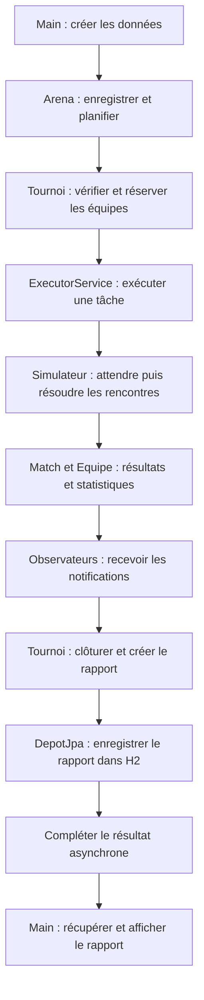
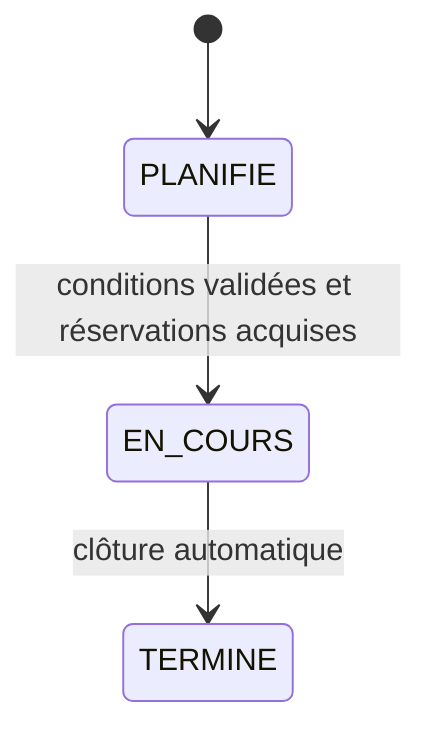

# IMT Arena — Tournois e-sport

Bibliothèque Java 21 et démonstration console pour planifier, simuler et archiver des tournois toutes rondes. Sans Spring : Maven, JUnit 5, Hibernate/JPA et H2 fichier.

## Accéder au projet

- [Code Java](src/main/java/fr/imt/arena/) — [programme Main](src/main/java/fr/imt/arena/Main.java)
- [Tests JUnit](src/test/java/fr/imt/arena/)
- [Dossier de conception PDF — 2 pages](docs/DOSSIER_CONCEPTION.pdf)
- [Analyse et traçabilité](docs/ANALYSE.md)
- [Préparation à l’entretien](docs/ENTRETIEN.md)
- [Télécharger le ZIP complet](https://github.com/TomGrpt/POO/raw/refs/heads/main/livraison/TP_Tournoi_Esport.zip)

## Compiler, tester, exécuter

Prérequis : **JDK 21 complet** (pas seulement un JRE), Maven 3.9+, accès Maven Central au premier lancement.
Depuis la racine du projet :

```sh
mvn clean verify
mvn exec:java
```

La démonstration crée six équipes de trois joueurs, deux arbitres, un jeu solo et un jeu collectif. Deux tournois successifs illustrent le partage des équipes, les classements, les matchs, les notifications et les rapports. Chaque tournoi a sa propre graine fixe ; les rapports s'ajoutent à chaque exécution.

Dans l'environnement cloud préparé, utiliser `./mvn-cloud` à la place de `mvn`. Il sélectionne le JDK complet, le routage proxy et le cache Maven inscriptible installés hors du dépôt. Ce raccourci est facultatif et spécifique à `/workspace` ; sur votre machine, les commandes Maven standard suffisent.

## Persistance

Seuls les rapports sont des entités JPA. Base par défaut : `jdbc:h2:file:./data/arena`, donc fichier `data/arena.mv.db` relatif au répertoire d'exécution. Le dossier est créé automatiquement. Aucun serveur H2 séparé, aucune clé ni variable secrète nécessaire. Fermer Arena avant DepotJpa (ordre assuré par try-with-resources). Ne pas lancer deux JVM simultanées sur ce même fichier. Pour repartir à zéro, fermer l'application puis supprimer `data/` ; cette opération efface les rapports.

`DepotJpa.tous()` et `parJeu(String)` renvoient les rapports détachés. Une erreur de stockage est propagée par `attendreRapport`, jamais présentée comme une sauvegarde réussie.

## Organisation

- `src/main/java/fr/imt/arena/` : personnes, jeux, équipes, matchs, tournoi, simulateur, service Arena, stratégies, observateurs, dépôt et Main.
- `src/main/resources/META-INF/persistence.xml` : configuration JPA/H2.
- `src/test/java/fr/imt/arena/` : règles métier, tournois, simulation, concurrence, persistance fichier.
- `docs/DOSSIER_CONCEPTION.pdf` : dossier de **deux pages**, diagramme compris.
- `docs/classes.mmd` : source Mermaid complète du diagramme de classes.
- `docs/ANALYSE.md` : analyse préalable et matrice exigences / implantation / tests.
- `docs/ENTRETIEN.md` : dix questions et réponses adaptées au code.
- `docs/VALIDATION.md` : vérifications effectivement exécutées et limites.

## Conventions métier et temporelles

Les identifiants des personnes sont uniques, comme supposé dans le PDF. Le registre Arena rejette les doublons d'identité/noms ; utiliser une seule Arena pour gérer une saison. Un nom de jeu, sensible à la casse après suppression des espaces externes, identifie sa définition. Les équipes doivent être enregistrées pour apparaître au classement général ; inscrire une équipe au tournoi ne l'ajoute pas automatiquement au registre.

Les points généraux et victoires des coachs sont cumulatifs ; le vainqueur d'un tournoi dépend de ses points locaux, puis du nom en cas d'égalité. S'il n'y a aucun match joué, il n'y a pas de vainqueur. Tous les joueurs de l'équipe progressent après une victoire, même ceux non sélectionnés ; une promotion acquise n'est pas perdue lors d'un transfert. Les effectifs et le coach ne changent pas pendant la réservation.

Une tâche de tournoi représente des arènes logiques : résultats par lots d'au plus A matchs. Durée cible = M × tempsParMatch / A ; le dernier lot est proratisé si nécessaire. Exemple du PDF : 15 × 100 ms / 3 = 500 ms, auxquels s'ajoutent les coûts d'exécution et de persistance. Il n'est pas ajouté de contrainte de planning interdisant une équipe ou un arbitre dans plusieurs rencontres logiques simultanées. Les arbitres occupés sont ceux engagés dans au moins un tournoi ; un arbitre peut être partagé entre tournois, seule sa qualification étant imposée. Les matchs annulés n'augmentent ni les points ni le nombre de matchs arbitrés.

`Tournoi.consulter()` fournit une photographie immuable cohérente (état, points locaux, résultats). Les autres accesseurs sont protégés individuellement ; plusieurs appels successifs peuvent naturellement observer l'avancement. `attendreRapport(Duration)` borne l'attente et inclut la fin de la sauvegarde et la libération des ressources. Les collections rendues sont non modifiables.

Les stratégies et observateurs sont des extensions synchrones : elles doivent terminer rapidement, respecter l'interruption et ne pas appeler `Arena.close()` depuis un worker. Leurs exceptions sont gérées ; un code utilisateur qui ignore indéfiniment l'interruption ne peut pas être arrêté de force par Java. Pour un jeu de tests déterministe, employer des stratégies sans état mutable partagé et un dépôt temporaire.

## Livrable et dossier

L'archive livrée contient sources, configurations, tests, README et documentation ; elle exclut `.git`, `target`, les caches et les bases de démonstration. Le PDF de conception est déjà généré : aucun outil de génération documentaire n'est requis pour compiler le projet. La source Mermaid peut être visualisée dans un éditeur compatible.

---

## Guide pédagogique — comprendre et reconstruire le projet

Ce guide s'adresse à des étudiants de première année d'école d'ingénieurs. Il explique le rôle du code, les raisons des choix de conception et l'ordre dans lequel on peut construire une application semblable. Les liens ouvrent les fichiers réellement présents dans le dépôt. Les petits extraits servent à expliquer une idée ; le programme complet à exécuter est [Main.java](src/main/java/fr/imt/arena/Main.java).

### Sommaire du guide

1. [Le problème à résoudre](#1-le-problème-à-résoudre)
2. [Se repérer dans le projet Maven](#2-se-repérer-dans-le-projet-maven)
3. [Les notions Java à connaître](#3-les-notions-java-à-connaître)
4. [Les personnes et leurs responsabilités](#4-les-personnes-et-leurs-responsabilités)
5. [Les jeux et le polymorphisme](#5-les-jeux-et-le-polymorphisme)
6. [Les équipes et les matchs](#6-les-équipes-et-les-matchs)
7. [Les tournois et leurs états](#7-les-tournois-et-leurs-états)
8. [Arena : organiser une saison](#8-arena--organiser-une-saison)
9. [La simulation et les threads](#9-la-simulation-et-les-threads)
10. [Strategy et Observer](#10-strategy-et-observer)
11. [La persistance JPA et H2](#11-la-persistance-jpa-et-h2)
12. [Lire Main du début à la fin](#12-lire-main-du-début-à-la-fin)
13. [Comprendre les tests](#13-comprendre-les-tests)
14. [Reconstruire puis faire évoluer le projet](#14-reconstruire-puis-faire-évoluer-le-projet)

### 1. Le problème à résoudre

On souhaite gérer une saison de compétitions e-sport. Des personnes rejoignent des équipes, des équipes s'inscrivent à des tournois et chaque tournoi organise toutes les rencontres possibles entre ses équipes. Les résultats font évoluer les points et les statistiques. À la fin, un rapport est enregistré sur disque.

Il faut distinguer quatre responsabilités :

| Responsabilité | Question traitée | Classes principales |
|---|---|---|
| Modèle métier | Qu'est-ce qu'un joueur, une équipe, un match valide ? | `Personne`, `Equipe`, `Jeu`, `Match`, `Tournoi` |
| Coordination et simulation | Quel tournoi lancer ? Comment le faire progresser sans bloquer l'appelant ? | `Arena`, `Simulateur`, `ParametresSimulation` |
| Stockage | Comment conserver et rechercher les rapports ? | `Rapport`, `DepotRapports`, `DepotJpa` |
| Démonstration | Quelles données créer et quoi afficher à l'utilisateur ? | `Main` |

Cette répartition évite de concentrer toutes les règles dans `main`. Par exemple, retirer un joueur d'une équipe engagée est interdit par `Equipe` elle-même : la règle reste vraie même si une autre interface utilisateur remplace la console.

Le diagramme suivant montre le chemin principal d'une exécution. C'est un diagramme de fonctionnement ; le diagramme de classes complet se trouve dans [docs/classes.mmd](docs/classes.mmd).



### 2. Se repérer dans le projet Maven

```text
POO/
├── pom.xml                         Dépendances et configuration de compilation
├── src/
│   ├── main/
│   │   ├── java/fr/imt/arena/       Code de l'application
│   │   └── resources/META-INF/
│   │       └── persistence.xml     Configuration de JPA
│   └── test/java/fr/imt/arena/      Code des tests
├── docs/                           Conception, UML, analyse, validation et oral
├── scripts/                        Préparation cloud et génération du dossier
├── mvn-cloud                       Lanceur Maven propre à l'environnement cloud
└── livraison/                      Archive ZIP remise avec le projet
```

`fr.imt.arena` est le **package** Java : un espace de noms qui regroupe les classes. Il correspond ici au chemin `fr/imt/arena/`. Les fichiers de tests utilisent le même package, ce qui permet aussi de tester les méthodes internes au package.

Le fichier [pom.xml](pom.xml) décrit le projet à Maven :

| Élément | Utilité dans ce projet |
|---|---|
| `groupId`, `artifactId`, `version` | Identifient le projet : `fr.imt:arena:1.0.0`. |
| `maven.compiler.release = 21` | Compile pour les fonctionnalités et l'API de Java 21. Un JDK complet est nécessaire. |
| Hibernate `6.6.5.Final` | Réalise la persistance selon l'API JPA. |
| H2 `2.3.232`, portée `runtime` | Fournit le moteur de base de données lors de l'exécution ; le code métier n'importe pas de classe H2. |
| JUnit Jupiter `5.11.4`, portée `test` | Sert uniquement à écrire et exécuter les tests, y compris paramétrés. |
| `maven-compiler-plugin` | Compile les sources Java. |
| `maven-surefire-plugin` | Exécute les tests JUnit pendant la construction. |
| `exec-maven-plugin` | Lance `fr.imt.arena.Main` avec les dépendances nécessaires. |

Pour lire les commandes Maven :

```sh
mvn compile       # Compiler l'application
mvn test          # Compiler et exécuter les tests
mvn clean verify  # Supprimer les anciennes sorties, reconstruire, tester et vérifier
mvn exec:java     # Exécuter Main après compilation
```

Les lignes ci-dessus sont des commandes séparées. Après un nouveau clonage, commencer par `mvn clean verify`, puis `mvn exec:java`. Maven crée `target/`, contenant notamment les classes compilées, le JAR et les résultats des tests dans `target/surefire-reports/`. Le JAR produit n'embarque pas toutes les dépendances : la commande d'exécution documentée est `mvn exec:java`.

Les fichiers d'accompagnement ont aussi un rôle précis : `.gitignore` exclut les sorties de compilation, les bases et les logs ; `.gitattributes` indique que les PDF, PNG et ZIP sont binaires. [scripts/cloud_setup.sh](scripts/cloud_setup.sh) installe les outils dans `/workspace/tools`, vérifie les empreintes des téléchargements et prépare Maven pour le proxy. [mvn-cloud](mvn-cloud) sélectionne ces outils. Sur une machine personnelle équipée de Maven et du JDK 21, ces deux fichiers ne sont pas nécessaires.

[scripts/generer_dossier.py](scripts/generer_dossier.py) génère le dossier PDF à partir du diagramme Graphviz et du texte de conception. Sa régénération facultative utilise Python, ReportLab, Graphviz et les polices Open Sans installées sur la machine ; ces outils ne sont pas des dépendances Java et ne sont pas requis pour compiler ou lancer l'application. Le PDF déjà généré est fourni.

### 3. Les notions Java à connaître

Voici comment les notions vues en cours apparaissent dans le code :

| Notion | Signification | Exemple réel |
|---|---|---|
| Classe et objet | Une classe décrit un type ; un objet est une instance de ce type. | `new Equipe("Les Lynx")` crée une équipe. |
| Constructeur | Initialise un objet et vérifie ses conditions de création. | `Tournoi(...)` refuse un budget négatif ou cinq arènes. |
| `private` | Le champ ou la méthode n'est accessible que depuis sa classe. | Le total `points` d'une équipe ne peut pas être écrit librement depuis Main. |
| `final` | Une variable ne peut plus recevoir une autre valeur ; une classe finale ne peut pas être étendue. | Le nom d'une équipe est fixe, et `Joueur` est une classe finale. |
| `abstract` | La classe sert de base et ne s'instancie pas directement. | On crée un `Joueur`, pas un simple `Personne`. |
| `extends` | Une classe hérite d'une autre. | `Joueur extends Personne`. |
| `implements` | Une classe s'engage à respecter une interface. | `Equipe implements Classe`. |
| `@Override` | Signale qu'une méthode redéfinit une méthode héritée ou implémente une interface. | `JeuSolo.joueursParEquipe()`. |
| Méthode sans modificateur d'accès | Est accessible aux classes du même package, mais pas aux appelants d'un autre package. | `Equipe.reserver(...)`, `Match.terminer(...)`. |
| `enum` | Définit une liste fermée de valeurs nommées. | `EtatMatch.JOUE`. |
| `record` | Fournit une forme concise pour représenter des données avec des composants finaux. | `ParametresSimulation` et `VueTournoi`. |
| `Optional<T>` | Représente un résultat qui peut être absent. | `match.vainqueur()` est vide avant une victoire ou après annulation. |
| Exception | Signale que l'opération ne peut pas être réalisée normalement. | Ajouter un joueur déjà rattaché déclenche `IllegalStateException`. |

Attention à `final` : une référence finale à une `ArrayList` ne rend pas son contenu immuable. Le projet utilise donc aussi des copies non modifiables, par exemple `List.copyOf(joueurs)`.

Deux familles d'erreurs sont distinguées : `IllegalArgumentException` signifie qu'un argument ne convient pas, par exemple un nombre d'arènes hors limites ; `IllegalStateException` signifie que l'état actuel interdit l'action, par exemple retirer un joueur pendant un tournoi. `Objects.requireNonNull` rejette une référence obligatoire absente, avec une `NullPointerException`.

### 4. Les personnes et leurs responsabilités

#### `Personne` : les données communes

[Personne.java](src/main/java/fr/imt/arena/Personne.java) contient l'identifiant, le nom, le prénom, le pseudo, le genre et le téléphone. Les trois catégories de personnes héritent de ces informations. Le constructeur est `protected`, afin d'être utilisé par les sous-classes.

Les sous-classes appellent le constructeur parent avec `super(...)`. Les données d'identité sont privées, finales et accessibles en lecture : le projet ne propose pas de setters pour les modifier.

`equals` et `hashCode` se fondent sur l'identifiant. Deux personnes de même identifiant sont donc considérées égales, même si ce sont deux instances Java différentes. Le sujet suppose les identifiants uniques ; `Arena.ajouter(Personne)` rejette aussi l'enregistrement d'un identifiant déjà connu. À l'inverse, les équipes utilisent ici l'identité de l'objet ; leur nom unique est contrôlé dans les registres et les inscriptions.

[Genre.java](src/main/java/fr/imt/arena/Genre.java) contient les valeurs `FEMME`, `HOMME`, `NON_BINAIRE` et `NON_PRECISE`. [Verifications.java](src/main/java/fr/imt/arena/Verifications.java) centralise le contrôle des chaînes obligatoires : refuser `null`, le texte vide ou composé d'espaces, puis supprimer les espaces aux extrémités avec `strip()`.

#### `Joueur` : appartenance et progression

[Joueur.java](src/main/java/fr/imt/arena/Joueur.java) ajoute une équipe éventuelle, un statut et le nombre de victoires depuis l'arrivée dans l'équipe. [StatutJoueur.java](src/main/java/fr/imt/arena/StatutJoueur.java) définit `AMATEUR` et `PROFESSIONNEL`.

| Méthode | Rôle |
|---|---|
| `equipe()` | Lire l'équipe éventuelle sous forme d'`Optional`. |
| `statut()`, `victoiresDepuisArrivee()` | Lire la progression actuelle. |
| `rejoindre(Equipe)` | Refuser une seconde appartenance et remettre le compteur d'arrivée à zéro. |
| `quitter(Equipe)` | Vérifier l'équipe de départ, supprimer le rattachement et remettre le compteur à zéro. |
| `victoire()` | Incrémenter le compteur et rendre professionnel dès la troisième victoire. |

Les trois dernières méthodes sont internes au package. L'utilisateur de la bibliothèque passe par `Equipe.ajouter` et `Equipe.retirer`, pour que la liste de l'équipe et le rattachement du joueur soient mis à jour ensemble.

Exemple : un amateur gagne deux matchs dans A, quitte A puis rejoint B. Il doit gagner trois matchs avec B pour être promu. S'il était déjà professionnel avant son transfert, il le reste : quitter une équipe ne remet pas son statut à amateur.

#### `Coach` : une équipe, une carrière

[Coach.java](src/main/java/fr/imt/arena/Coach.java) possède aussi une équipe éventuelle. `rejoindre` interdit un second engagement ; `quitter` vérifie l'équipe concernée. Son compteur `victoires` n'est jamais remis à zéro lors d'un changement d'équipe, car il décrit toute sa carrière. `Equipe.nommer` organise l'affectation.

#### `Arbitre` et `Qualifie`

[Arbitre.java](src/main/java/fr/imt/arena/Arbitre.java) implémente [Qualifie.java](src/main/java/fr/imt/arena/Qualifie.java). L'interface définit une capacité : répondre à `estQualifie(Jeu)`. Elle peut être implémentée par d'autres classes à l'avenir, sans qu'elles héritent d'Arbitre.

L'arbitre conserve un ensemble non modifiable de jeux et doit posséder au moins une qualification. `matchJoue()` augmente son nombre de matchs arbitrés. Les méthodes internes `engager()` et `liberer()` suivent son nombre d'engagements dans les tournois ; `disponible()` est vrai quand ce nombre vaut zéro. Un compteur est utilisé plutôt qu'un booléen, car le modèle autorise le partage d'un arbitre entre plusieurs tournois.

### 5. Les jeux et le polymorphisme

[Jeu.java](src/main/java/fr/imt/arena/Jeu.java) est abstraite. Elle conserve un nom et un nombre de manches strictement positif. Sa méthode abstraite `joueursParEquipe()` décrit la taille de composition demandée.

- [JeuSolo.java](src/main/java/fr/imt/arena/JeuSolo.java) renvoie toujours `1`.
- [JeuCollectif.java](src/main/java/fr/imt/arena/JeuCollectif.java) conserve une taille validée entre `3` et `5`.

`Jeu.selectionner(effectif)` vérifie que la liste est assez grande, puis prend les premiers joueurs nécessaires dans l'ordre de l'effectif. La sélection n'est pas aléatoire. La copie retournée est non modifiable. Le nombre de manches est conservé, mais les manches ne sont pas simulées individuellement : le sujet demande une simulation temporelle des matchs.

```java
Jeu duel = new JeuSolo("Duel", 3);
Jeu collectif = new JeuCollectif("Arena 3", 5, 3);
```

Les deux variables sont de type `Jeu`, mais `joueursParEquipe()` exécute la version correspondant à l'objet réel. C'est le **polymorphisme**. `Match` appelle `jeu.selectionner(...)` sans avoir besoin de demander « est-ce un jeu solo ou collectif ? ».

L'identité d'un jeu repose sur son nom, après nettoyage des espaces externes, et reste sensible à la casse. `equals` et `hashCode` utilisent ce nom, ce qui permet notamment de rechercher une qualification dans un ensemble. Il faut employer une définition cohérente pour chaque nom de jeu ; le registre Arena rejette les doublons de nom.

### 6. Les équipes et les matchs

#### `Equipe` : protéger les invariants

[Equipe.java](src/main/java/fr/imt/arena/Equipe.java) regroupe le nom, la liste des joueurs, le coach éventuel, les points et une réservation éventuelle.

Un **invariant** est une propriété qui doit rester vraie après chaque opération autorisée. Ici, un joueur ne doit jamais appartenir simultanément à deux équipes. Cette règle est vérifiée dans le modèle, plutôt que d'être laissée à la bonne volonté du Main.

```java
Equipe equipe = new Equipe("Les Lynx");
Joueur joueur = new Joueur("j1", "Martin", "Alex", "Pixel",
    Genre.NON_PRECISE, "0100000000", StatutJoueur.AMATEUR);
equipe.ajouter(joueur);
```

`ajouter` vérifie d'abord que l'équipe n'est pas réservée, demande au joueur de la rejoindre, puis l'ajoute à la liste. Si le joueur est déjà rattaché, l'exception interrompt l'opération avant la modification de cette liste.

`retirer` retrouve l'instance réellement inscrite, lui fait quitter l'équipe puis la retire. `nommer` vérifie d'abord que le nouveau coach peut rejoindre l'équipe, avant de détacher l'ancien : un refus ne fait donc pas perdre le coach déjà présent. `nommer(null)` retire le coach, si l'équipe n'est pas engagée.

Les méthodes internes `reserver(proprietaire, jeu)` et `liberer(proprietaire)` figent puis débloquent l'effectif. Le propriétaire est le tournoi : une autre réservation ne peut pas être libérée par erreur. `verifier(jeu)` impose un coach et une composition suffisante au démarrage. Il est permis de construire une équipe encore vide, puis de la compléter avant son tournoi.

`victoire()` ajoute trois points, incrémente les victoires du coach et appelle `victoire()` pour chaque joueur de l'effectif, y compris les remplaçants. Les valeurs ne sont pas modifiées par un setter public.

L'interface [Classe.java](src/main/java/fr/imt/arena/Classe.java) exige `nom()` et `points()`. Elle fournit aussi le comparateur `CLASSEMENT` des équipes : points décroissants, puis nom croissant. Son nom signifie ici « qui peut être classé » ; il ne s'agit pas du mot-clé Java `class`.

#### `Match` : conserver et résoudre une rencontre

[Match.java](src/main/java/fr/imt/arena/Match.java) conserve les deux équipes, le jeu, l'arbitre, les compositions sélectionnées, l'état et le vainqueur éventuel. Son constructeur refuse une équipe contre elle-même, un arbitre non qualifié ou un effectif insuffisant.

[EtatMatch.java](src/main/java/fr/imt/arena/EtatMatch.java) définit trois états :

```text
PREVU ── incident ──> ANNULE
PREVU ── victoire ─> JOUE
```

La méthode interne `terminer(incident, strategie, random)` ne peut être exécutée qu'une fois. En cas d'incident, elle annule sans point et sans augmenter le compteur de l'arbitre. Sinon, elle demande un vainqueur à la stratégie, vérifie qu'il est l'un des deux participants, applique la victoire et augmente le compteur de matchs arbitrés. Aucun état « match nul » n'est prévu.

Le modèle du match ne dort pas et n'affiche rien : la gestion du temps appartient au simulateur, l'affichage au Main.

### 7. Les tournois et leurs états

#### Paramètres et inscriptions

[Tournoi.java](src/main/java/fr/imt/arena/Tournoi.java) contient le nom, le jeu, la date, le budget, le nombre d'arènes, les équipes inscrites et les rencontres. Le budget est un `BigDecimal`, adapté aux montants décimaux, initialisé par exemple avec `new BigDecimal("1000")`. Il est donné et n'est pas calculé par le programme.

`inscrire(Equipe)` est autorisée uniquement à l'état planifié et refuse deux équipes de même nom. Le nombre minimal de quatre équipes est vérifié au lancement : cela permet de construire progressivement le tournoi.

[EtatTournoi.java](src/main/java/fr/imt/arena/EtatTournoi.java) décrit la progression :



Un lancement refusé laisse le tournoi planifié. Un tournoi terminé n'est pas réutilisé pour une nouvelle simulation. La date sert à ordonner les tournois : il n'y a pas de minuterie attendant la date réelle du calendrier.

#### `demarrer` : contrôler, réserver et générer

La méthode interne `demarrer(arbitres)` vérifie l'état, le minimum de quatre équipes et la présence d'arbitres. Arena lui fournit la liste des arbitres qualifiés. Elle réserve ensuite chaque équipe ; chaque réservation vérifie le coach, l'effectif et l'absence d'autre engagement.

Si une réservation ou la création des matchs échoue, les réservations déjà acquises sont libérées. Ce retour à l'état précédent est un **rollback**, ici réalisé en mémoire. Il ne faut pas le confondre avec le rollback de transaction utilisé plus loin en base de données.

Les rencontres sont générées avec deux indices, le second commençant après le premier :

```java
for (int i = 0; i < equipes.size(); i++) {
    for (int j = i + 1; j < equipes.size(); j++) {
        // Créer le match entre equipes.get(i) et equipes.get(j).
    }
}
```

Avec A, B, C et D, on obtient AB, AC, AD, BC, BD, CD : six matchs, sans AA ni retour BA. Le nombre est `n × (n − 1) / 2`. Pour six équipes, cela fait quinze rencontres. L'arbitre est affecté à tour de rôle avec l'opérateur modulo `%`, qui permet de revenir au début de la liste.

#### Résultats, classement local et regroupements

`terminerMatch` fait évoluer un match et ajoute trois points dans la map locale si une équipe gagne. Cette map est distincte des points cumulés de `Equipe` : une équipe peut gagner plusieurs tournois, mais chaque tournoi calcule son propre classement.

`classement()` trie par points locaux décroissants, puis par nom. `matchsParVainqueur()` associe chaque équipe gagnante à sa liste de matchs remportés ; les incidents et les équipes sans victoire sont exclus. L'ordre de la `LinkedHashMap` suit le classement local.

`cloturer()` compte les matchs joués, détermine le vainqueur local, passe à `TERMINE`, libère les équipes et crée un `Rapport`. Si aucun match n'a été joué, le vainqueur est absent. En cas d'égalité de points, le nom départage les équipes.

#### Lire une photographie cohérente

[VueTournoi.java](src/main/java/fr/imt/arena/VueTournoi.java) est un `record` contenant l'état, les points locaux et une liste de `ResultatMatch`, un autre record. `consulter()` construit ces valeurs sous le verrou du tournoi.

```java
VueTournoi vue = tournoi.consulter();
EtatTournoi etatObserve = vue.etat();
Map<String, Integer> pointsObserves = vue.points();
```

La vue conserve ses valeurs même si la simulation progresse ensuite. Ses collections sont copiées, et ses résultats contiennent des noms et des états, pas des références vers des matchs vivants. À l'inverse, `matchs()` renvoie une liste non modifiable dont les objets Match peuvent encore évoluer. Non modifiable ne signifie donc pas toujours « photographie complète ».

`attendreRapport(delai)` utilise un `CompletableFuture<Rapport>` : une valeur qui sera fournie plus tard. Le délai limite uniquement l'attente de l'appelant ; son expiration n'annule pas la simulation.

| Résultat de l'attente | Signification |
|---|---|
| Un `Rapport` est retourné | La clôture, la sauvegarde et la libération des engagements suivis par Arena ont abouti. |
| `TimeoutException` | Le résultat n'était pas disponible avant la limite. |
| `ExecutionException` | La simulation ou la sauvegarde a échoué ; `getCause()` donne la cause. |
| `InterruptedException` | Le thread qui attend a reçu une interruption. |

L'état `TERMINE` est fixé avant l'écriture en base. Il ne suffit donc pas, à lui seul, à prouver que la sauvegarde a réussi : attendre le rapport fournit cette confirmation.

### 8. Arena : organiser une saison

[Arena.java](src/main/java/fr/imt/arena/Arena.java) est le point d'entrée pour enregistrer des objets, planifier, lancer et consulter les compétitions. Elle reçoit un `DepotRapports` dans son constructeur : cette dépendance est fournie de l'extérieur. On parle d'**injection de dépendance**, même sans Spring.

| Méthodes publiques | Utilisation |
|---|---|
| `ajouter(Personne)`, `ajouter(Jeu)`, `ajouter(Equipe)` | Enregistrer les objets et refuser les clés déjà présentes. Même nom de méthode, paramètres différents : c'est la surcharge. |
| `planifier(Tournoi)` | Enregistrer un tournoi encore planifié et l'ajouter à la file. |
| `lancerSuivant(parametres, graine)` | Réserver et lancer le tournoi chronologiquement prioritaire. |
| `equipe(nom)` | Retrouver une équipe à partir de son nom. |
| `planifies()`, `termines()` | Lister les tournois, respectivement par date croissante et budget décroissant. |
| `classement()` | Trier les équipes enregistrées par leurs points généraux, puis par nom. |
| `arbitres(true)`, `arbitres(false)` | Obtenir les arbitres disponibles ou occupés. |
| `matchs(equipe)` | Réunir les rencontres d'une équipe à travers les tournois connus. |
| `nombreEnCours()` | Lire le nombre de tâches de tournoi suivies comme actives. |
| `observer(ecouteur)`, `erreursObservateurs()` | Ajouter un observateur et consulter les erreurs de callbacks. |
| `close()` | Fermer le pool et attendre l'arrêt de ses tâches. |

Enregistrer une équipe dans Arena et l'inscrire à un tournoi sont deux actions distinctes : l'une la rend accessible au registre général ; l'autre l'ajoute aux participants de la compétition.

#### Pourquoi ces collections ?

Une collection est choisie pour les opérations fréquentes qu'elle facilite. `O(1)` signifie ici un coût moyen qui ne croît pas avec le nombre d'éléments ; `O(log n)` croît lentement ; `O(n)` parcourt les éléments. Ce sont des ordres de grandeur, pas des durées en millisecondes.

| Collection réelle | Besoin couvert | Choix et précaution |
|---|---|---|
| `HashMap<String, Equipe>` et autres registres | Retrouver un objet par une clé unique | Recherche moyenne `O(1)` ; aucun ordre garanti. |
| `LinkedHashMap<String, Personne>` | Registre des personnes | Recherche moyenne `O(1)` et conservation de l'ordre d'ajout, utile pour une affectation stable des arbitres. |
| `PriorityQueue<Tournoi>` | Choisir le prochain tournoi | Tête en `O(1)`, ajout/retrait en `O(log n)`. Son itérateur n'est pas trié ; la liste affichée est explicitement triée. |
| `HashSet<Tournoi>` | Suivre les tournois en cours | Unicité et ajout/retrait moyens en `O(1)`. |
| `Set<Jeu>` créé par `Set.copyOf` | Qualifications d'un arbitre | Pas de doublon ni de mutation extérieure ; la classe concrète de l'ensemble n'est pas imposée par l'API. |
| `ArrayList` | Effectifs, inscriptions, rencontres | Ordre stable, accès par indice en `O(1)`, ajout amorti en `O(1)`. |
| `HashMap<Equipe, Integer>` | Points locaux d'un tournoi | Associer directement une équipe à son score. |
| `LinkedHashMap<Equipe, List<Match>>` | Matchs regroupés par gagnant | Conserver l'ordre de classement lors du parcours des groupes. |
| `CopyOnWriteArrayList` | Abonnements d'observateurs | Adaptée aux ajouts rares et lectures fréquentes ; un ajout copie le tableau interne. |
| `ConcurrentLinkedQueue` | Erreurs des observateurs | Accepter les erreurs envoyées par plusieurs workers sans utiliser une simple liste non protégée. |

`Tournoi implements Comparable<Tournoi>` définit son ordre naturel : date, puis nom. Un `Comparator`, lui, exprime un ordre choisi pour une opération : classement par points, ou liste des tournois terminés par budget.

On ne range pas durablement les équipes dans un `TreeSet` trié sur leurs points : les points changent, et l'arbre ne se réorganiserait pas tout seul. `Arena.classement()` capture d'abord les points de chaque équipe, puis trie à partir de ces valeurs fixes. Cette capture stabilise le comparateur ; elle ne constitue pas une transaction globale simultanée sur toutes les équipes.

Les chaînes de méthodes comme `stream().filter(...).sorted(...).toList()` sont des **streams** : sélectionner certains éléments, les trier puis produire une liste. `map` transforme chaque élément ; `flatMap` aplatit plusieurs listes, comme les matchs de plusieurs tournois. Ces opérations ne créent pas automatiquement de threads parallèles.

### 9. La simulation et les threads

#### Distinguer le thread principal et les workers

Un thread est un fil d'exécution. Le programme principal utilise un thread pour créer les objets et afficher les résultats. `Arena` possède un `ExecutorService` créé avec `Executors.newFixedThreadPool(3)` : un pool de trois threads de travail, appelés workers.

Une tâche représente un tournoi complet. Il n'y a pas un thread par joueur, par match ou par arène. Après `lancerSuivant`, l'appelant peut consulter le tournoi pendant que le worker travaille. Si le Main appelle ensuite `attendreRapport`, il choisit d'attendre à cet endroit précis.

Un pool de taille trois ne suffirait pas seul à interdire un quatrième tournoi déclaré « en cours » : il pourrait simplement mettre la quatrième tâche en attente. Le projet contrôle donc aussi explicitement `enCours.size()` avant tout lancement.

#### Rendre le lancement atomique

Une méthode `synchronized` prend le verrou associé à son objet. Un seul thread à la fois peut exécuter les sections synchronisées sur ce même objet. La libération puis la reprise du verrou assurent aussi la visibilité des écritures entre threads.

`Arena.lancerSuivant` réalise sous le même verrou : le contrôle de fermeture, le contrôle des trois places, le choix du prochain tournoi, la préparation des arbitres, le démarrage, l'enregistrement du tournoi actif et la soumission au pool.

Sans cela, deux appels pourraient lire simultanément « deux tournois actifs », puis en ajouter chacun un et atteindre quatre. Ici, le second appel voit la modification du premier. Si le tournoi prioritaire n'est pas prêt, le lancement échoue ; le service ne saute pas silencieusement vers un tournoi plus tardif.

Les protections sont réparties selon les données :

| Objet protégé | Données ou opération protégées |
|---|---|
| `Arena` | Registres, file, capacité et lancement. |
| `Equipe` | Effectif, coach, points et réservation. |
| `Joueur`, `Coach`, `Arbitre` | Appartenance et compteurs propres à chaque personne. |
| `Tournoi` | États, résultats, points locaux et création des vues cohérentes. |
| `Match` | Transition de résultat et lecture de son état. |

Réserver une équipe fige son effectif et son coach. Puisqu'ils ne peuvent appartenir qu'à une équipe à la fois, ils ne peuvent pas être réaffectés pour contourner cette réservation. En cas d'échec partiel, les équipes déjà réservées sont libérées.

Le sommeil et les callbacks sont exécutés sans conserver le verrou du tournoi ; l'écriture en base se fait sans conserver le verrou d'Arena. Cela permet aux consultations et aux autres tournois de continuer. Les méthodes de modification métier sont courtes et n'attendent pas de réponse de l'utilisateur.

#### `ParametresSimulation` : rendre les choix explicites

[ParametresSimulation.java](src/main/java/fr/imt/arena/ParametresSimulation.java) est un record contenant `tempsParMatch`, `probabiliteIncident` et `strategie`. Son constructeur vérifie une durée non négative, une probabilité finie dans `[0, 1]` et une stratégie présente. `Duration.ZERO` est autorisé pour des tests rapides.

```java
ParametresSimulation parametres = new ParametresSimulation(
    Duration.ofMillis(100), 0.10, Strategies.equitable());
```

`dureeNanos` calcule la durée cible. `Math.multiplyExact` signale un dépassement de capacité numérique au lieu de produire silencieusement un résultat faux.

#### `Simulateur` : le déroulement temporel

[Simulateur.java](src/main/java/fr/imt/arena/Simulateur.java) est une classe interne au package qui organise les lots de matchs. Elle ne gère ni le registre général ni la base de données.

1. Copier la liste des rencontres et mémoriser l'instant de départ avec `System.nanoTime()`.
2. Calculer la durée cible `nombreMatchs × tempsParMatch / arenes`.
3. Parcourir les rencontres par lots d'au plus `arenes` matchs.
4. Calculer le temps restant avant la fin du lot et dormir seulement s'il est positif.
5. Tirer un incident pour chaque rencontre du lot ; sinon laisser la stratégie choisir le gagnant.
6. Appliquer le résultat via `Tournoi.terminerMatch`, puis notifier les observateurs.

`System.nanoTime()` sert à mesurer un temps écoulé, pas à représenter une date. Calculer les échéances depuis le départ évite de rajouter systématiquement le coût de traitement à chaque sommeil.

Le modèle représente des **arènes logiques** : les résultats d'un lot sont traités successivement à son échéance, sans lancer de tâches de match supplémentaires. Pour quinze matchs à 100 ms avec trois arènes, on obtient cinq lots et une cible de 500 ms. Avec quatre arènes, les trois derniers matchs forment un lot proratisé de 75 ms : `100 + 100 + 100 + 75 = 375 ms`. Ce choix respecte la formule agrégée du sujet ; il ne représente pas un planning réel où chaque match du dernier lot durerait obligatoirement 100 ms. Le système et la persistance peuvent ajouter du temps à l'exécution mesurée.

Chaque tournoi reçoit son propre `new Random(graine)`. À ordre des rencontres, paramètres et stratégie identiques, une même graine reproduit les mêmes tirages. Les tests utilisent des équipes neuves pour ne pas dépendre de scores cumulés précédents ; une stratégie personnalisée partageant un état mutable pourrait compromettre cette reproductibilité.

#### Clôture, erreurs et arrêt propre

La méthode privée `Arena.simuler` appelle le simulateur, annule les rencontres encore prévues si une erreur ou une interruption a arrêté le déroulement, clôture, puis demande la sauvegarde. Un bloc `finally` libère les engagements des arbitres et retire le tournoi de l'ensemble actif. Le futur reçoit soit le rapport, soit une erreur : une sauvegarde échouée n'est pas annoncée comme réussie.

`Arena.close()` interdit les nouvelles soumissions et appelle `shutdown()`. Elle attend jusqu'à 30 secondes, puis demande une interruption avec `shutdownNow()` et attend encore jusqu'à 10 secondes. Si le thread qui ferme est lui-même interrompu, le code interrompt les workers, attend leur arrêt et restaure son indicateur d'interruption. Une tâche non coopérative entraîne une erreur d'arrêt.

Une interruption est une demande de coopération, pas un arrêt forcé. Les stratégies et observateurs ajoutés doivent donc terminer rapidement, respecter les interruptions et ne pas appeler `Arena.close()` depuis un worker, qui se mettrait à attendre son propre arrêt.

### 10. Strategy et Observer

#### Strategy : changer la manière de gagner

[StrategieVainqueur.java](src/main/java/fr/imt/arena/StrategieVainqueur.java) est une interface fonctionnelle : elle a une seule méthode abstraite, `choisir(premiere, seconde, random)`. Une expression lambda peut fournir cette méthode sans créer une nouvelle classe nommée.

[Strategies.java](src/main/java/fr/imt/arena/Strategies.java) fournit trois possibilités :

| Stratégie | Règle |
|---|---|
| `equitable()` | `random.nextBoolean()` donne une chance sur deux à chaque participant. |
| `meilleure()` | Choisit selon les points généraux, puis le nom ; utile pour des tests déterministes. |
| `ponderee()` | Donne à A une probabilité `(pointsA + 1) / (pointsA + pointsB + 2)`. Le `+1` conserve une chance pour une équipe sans point. |

Exemple de lecture de la lambda équitable :

```java
(a, b, r) -> r.nextBoolean() ? a : b
```

`a`, `b` et `r` sont les paramètres de `choisir`. L'opérateur conditionnel `condition ? valeurSiVrai : valeurSiFaux` renvoie ici l'une des deux équipes. Avec 9 points contre 3, la stratégie pondérée donne à la première `10 / 14`, soit environ 71,4 % de chances.

Le pattern Strategy résout un besoin concret : changer cette règle sans modifier `Match` ou `Simulateur`. `Match` vérifie tout de même la valeur rendue ; une stratégie ne peut pas désigner une troisième équipe.

#### Observer : informer sans imposer l'affichage

[EcouteurMatch.java](src/main/java/fr/imt/arena/EcouteurMatch.java) définit `matchTermine(Match)`. Un composant s'abonne avec `Arena.observer(...)`. Dans le Main, l'observateur compte les notifications :

```java
AtomicInteger notifications = new AtomicInteger();
arena.observer(match -> notifications.incrementAndGet());
```

`AtomicInteger` permet l'incrément depuis plusieurs workers sans perdre d'ajout. Un simple `int++` partagé ne fournirait pas cette garantie. Chaque match résolu ou annulé produit une notification ; le compteur final de la démonstration vaut donc trente.

Les abonnements sont copiés au lancement du tournoi : un observateur ajouté plus tard sera pris en compte par les futurs lancements. Les callbacks s'exécutent sur le worker du tournoi, de façon synchrone. Une `RuntimeException` d'un observateur est collectée et n'empêche pas les notifications suivantes ; une boucle infinie ou une erreur fatale n'est pas rendue inoffensive par ce mécanisme.

Observer évite de coupler le modèle à une console ou à un journal particulier. Les mises à jour des points restent directement dans les objets métier : elles sont indispensables et ne doivent pas dépendre d'un observateur facultatif.

Factory et Builder n'ont pas été ajoutés : les constructeurs validants suffisent pour ces objets. Les méthodes de `Strategies` sont de simples méthodes de création de stratégies ; le projet ne construit pas pour autant une architecture Factory supplémentaire.

### 11. La persistance JPA et H2

#### Trois termes à distinguer

**JPA** définit comment des objets Java peuvent être associés à des données en base. **Hibernate** est l'outil qui réalise ce travail selon JPA. **H2** est le moteur de base de données qui stocke effectivement les lignes dans un fichier. Le programme utilise l'espace de noms moderne `jakarta.persistence`.

#### `Rapport` : un résumé conservé

[Rapport.java](src/main/java/fr/imt/arena/Rapport.java) est la seule entité persistée. Elle contient les huit données du sujet : identifiant, nom du tournoi, date, jeu, nombres de matchs prévus et joués, nom du vainqueur, réussite.

| Annotation ou élément | Rôle |
|---|---|
| `@Entity` | Déclare une classe persistante. |
| `@Table(name = "rapports")` | Choisit le nom de la table. |
| `@Id` | Déclare la clé primaire. |
| `@GeneratedValue(strategy = IDENTITY)` | Laisse la base attribuer l'identifiant. |
| `@Column(nullable = false)` | Interdit une colonne SQL nulle pour le champ concerné. |
| Constructeur sans argument `protected` | Permet à JPA de reconstruire une instance lors d'une lecture. |

Les annotations sont placées sur les champs : Hibernate y accède directement, sans nécessiter de setters publics. Le rapport conserve des textes, comme le nom de l'équipe gagnante, plutôt que des associations JPA vers les équipes. Les joueurs, les matchs et les tournois vivants ne sont donc pas enregistrés.

La réussite est calculée par `Rapport.estReussi(prevus, joues)` :

```java
return joues * 10L >= prevus * 7L;
```

C'est la comparaison `joués / prévus >= 0,70`, sans division ni arrondi. Le suffixe `L` impose un calcul en `long`. Ainsi 7 matchs sur 10 suffisent ; 4 sur 6 ne suffisent pas, alors que 5 sur 6 suffisent. La méthode refuse aussi un nombre prévu nul ou des comptes incohérents.

#### `DepotRapports` : séparer le besoin du stockage

[DepotRapports.java](src/main/java/fr/imt/arena/DepotRapports.java) expose `sauvegarder`, `tous` et `parJeu`. Arena dépend de cette interface, pas des détails d'Hibernate. Les tests peuvent donc utiliser un dépôt en mémoire, tandis que le Main utilise [DepotJpa.java](src/main/java/fr/imt/arena/DepotJpa.java).

`DepotJpa` garde une `EntityManagerFactory` partagée et crée un `EntityManager` distinct pour chaque opération. La factory est conçue pour être partagée ; un EntityManager ne doit pas être utilisé simultanément par plusieurs threads.

Une sauvegarde suit trois étapes :

```java
transaction.begin();
em.persist(rapport);
transaction.commit();
```

Une **transaction** regroupe des modifications à valider ensemble. En cas de `RuntimeException`, le dépôt effectue un `rollback` si la transaction est encore active, puis propage l'erreur. Le try-with-resources ferme l'EntityManager dans tous les cas.

`tous()` et `parJeu()` utilisent JPQL, le langage de requête sur les entités. Par exemple :

```sql
select r from Rapport r where r.jeu = :jeu order by r.date, r.id
```

`Rapport` désigne la classe Java, pas directement le nom de table SQL `rapports`. `:jeu` est un paramètre renseigné séparément avec `setParameter`, plutôt que concaténé dans le texte de la requête. Les listes rendues sont non modifiables ; après fermeture de l'EntityManager, les objets retournés sont détachés de son suivi.

#### `persistence.xml` et le fichier H2

[persistence.xml](src/main/resources/META-INF/persistence.xml) déclare l'unité de persistance `arena`, le fournisseur Hibernate, la classe Rapport, le pilote H2 et l'URL du fichier. `RESOURCE_LOCAL` indique que l'application gère elle-même les transactions. `exclude-unlisted-classes` limite les entités à celles déclarées.

`hibernate.hbm2ddl.auto = update` demande à Hibernate de créer ou adapter le schéma au démarrage. C'est pratique pour ce TP ; ce mécanisme n'est pas un système complet de migrations de production. `hibernate.show_sql = false` désactive l'affichage direct des requêtes SQL, mais les messages de journalisation d'Hibernate peuvent encore apparaître.

Le constructeur `DepotJpa(String url)` permet de changer l'emplacement : les tests pointent vers des fichiers temporaires, sans toucher à `data/arena.mv.db`. À chaque nouvelle exécution du Main, de nouveaux rapports s'ajoutent ; les équipes en mémoire, elles, sont recréées.

### 12. Lire Main du début à la fin

[Main.java](src/main/java/fr/imt/arena/Main.java) sert de démonstration reproductible. Il orchestre les appels publics ; les règles métier restent dans leurs classes.

1. Ouvrir `DepotJpa`, puis `Arena`, dans un try-with-resources.
2. Créer et enregistrer le jeu solo `Duel` et le jeu collectif `Arena 3`.
3. Créer deux arbitres qualifiés pour les deux jeux.
4. Créer six équipes, chacune avec un coach et trois joueurs amateurs ; enregistrer les personnes et les équipes.
5. Créer deux tournois avec des dates et des budgets distincts, puis inscrire les six mêmes équipes aux deux.
6. Planifier le tournoi le plus tardif avant le plus proche, pour montrer que la priorité dépend de la date, pas de l'ordre d'ajout.
7. Ajouter l'observateur de comptage et choisir 100 ms par match, 10 % d'incidents et une stratégie équitable.
8. Lancer le premier tournoi avec la graine 42, afficher son état et les arbitres occupés, puis attendre son rapport au maximum dix secondes.
9. Afficher le classement local et les matchs regroupés par vainqueur.
10. Après la libération des équipes, lancer le second tournoi avec la graine 84 et attendre son rapport.
11. Afficher le classement général, les arbitres disponibles, les matchs de l'équipe 1, les tournois terminés, les rapports et le nombre de notifications.

Les deux tournois de cette démonstration sont successifs car ils partagent les équipes. Les tests de concurrence créent, eux, des équipes distinctes pour vérifier trois tournois réellement actifs en même temps.

Le try-with-resources ferme ses ressources dans l'ordre inverse de leur déclaration : d'abord Arena, ensuite DepotJpa. C'est essentiel : le pool doit avoir terminé ses écritures avant que la connexion de stockage ne soit fermée. Les `System.out.println` sont concentrés dans le Main ; la bibliothèque peut donc être réutilisée par une autre interface.

### 13. Comprendre les tests

Un test automatique prépare une situation, déclenche une action et vérifie un résultat attendu. C'est la structure **préparer / agir / vérifier**, souvent appelée Arrange / Act / Assert.

Les cinq suites totalisaient **42 exécutions réussies** lors de la validation décrite dans [docs/VALIDATION.md](docs/VALIDATION.md). Une méthode paramétrée compte pour plusieurs exécutions. Le nombre annoncé correspond à une exécution réelle, pas à une mesure de couverture de toutes les lignes.

| Fichier | Vérifications principales |
|---|---|
| [DomainTest.java](src/test/java/fr/imt/arena/DomainTest.java) | Appartenance et transfert, coach, promotion, qualification, points, annulation, tailles d'équipe, sélection et stratégies. |
| [TournamentTest.java](src/test/java/fr/imt/arena/TournamentTest.java) | Rencontres toutes rondes pour 4, 5 et 6 équipes, prérequis de lancement, rollback, priorité, budget et registre. |
| [SimulationTest.java](src/test/java/fr/imt/arena/SimulationTest.java) | Seuil de réussite, incidents, observateurs défaillants, reproductibilité, regroupements, durée, attente et erreurs de stratégie ou stockage. |
| [ConcurrencyTest.java](src/test/java/fr/imt/arena/ConcurrencyTest.java) | Trois admissions sous appels simultanés, réservations, mutations refusées, concurrence d'appartenance, arrêt et vues cohérentes. |
| [PersistenceTest.java](src/test/java/fr/imt/arena/PersistenceTest.java) | Sauvegarde automatique, relecture après fermeture/réouverture de fichiers H2 et sauvegardes depuis plusieurs workers. |

[Fixtures.java](src/test/java/fr/imt/arena/Fixtures.java) fournit des méthodes pour créer rapidement des joueurs, coachs, équipes et tournois de test. Son dépôt mémoire utilise une liste adaptée aux accès concurrents. Il est réservé aux tests ; l'application réelle emploie DepotJpa.

Pour lire les annotations et assertions :

| Élément JUnit | Sens |
|---|---|
| `@Test` | Déclare une méthode de test. |
| `@BeforeEach` | Prépare des objets neufs avant chaque test. |
| `@AfterEach` | Ferme les ressources après chaque test. |
| `@ParameterizedTest` avec `@ValueSource` ou `@CsvSource` | Rejoue la même règle sur plusieurs jeux de valeurs. |
| `@TempDir` | Fournit un répertoire temporaire propre au test. |
| `assertEquals` | Vérifie une égalité de valeurs. |
| `assertSame` | Vérifie que deux références désignent exactement le même objet. |
| `assertThrows` | Vérifie qu'une action invalide déclenche l'exception attendue. |

Exemple tiré du principe testé :

```java
Joueur joueur = a.joueurs().getFirst();
assertThrows(IllegalStateException.class, () -> b.ajouter(joueur));
```

`a` et `b` sont des équipes préparées par le test ; l'assertion prouve que l'interdiction est dans le modèle. Cette lambda décrit l'action que JUnit doit tenter.

Les tests de concurrence utilisent des `CountDownLatch`, sortes de barrières de synchronisation : retenir les workers empêche qu'un tournoi se termine avant que les huit demandes de lancement soient examinées. Les appels `Future.get` et les attentes de latch sont bornés par des délais. Cela teste une situation concurrente choisie, plutôt que de compter sur un sommeil arbitraire pour provoquer une course.

Pour cibler une suite :

```sh
mvn -Dtest=DomainTest test
mvn -Dtest=ConcurrencyTest test
mvn -Dtest=PersistenceTest test
```

Les tests ne prouvent pas mathématiquement l'absence de tout problème possible ; ils rendent vérifiables les règles critiques et protègent contre les régressions lors d'une modification.

### 14. Reconstruire puis faire évoluer le projet

#### Un ordre de construction conseillé

Voici une démarche pédagogique pour reconstruire cette architecture. Chaque étape ajoute une responsabilité clairement identifiée et doit pouvoir être expliquée avant la suivante.

| Étape | Travail à réaliser | Ce que l'on peut vérifier à ce stade |
|---|---|---|
| 1. Lire et reformuler le sujet | Lister objets, règles, états et ambiguïtés ; construire la matrice de traçabilité. | Savoir expliquer chaque règle avec un exemple valide et un contre-exemple. |
| 2. Dessiner le modèle | Définir Personne, ses sous-classes, Jeu, Equipe, Match et Tournoi ; préciser les relations. | Distinguer « hérite de » et « possède une référence vers ». |
| 3. Créer le projet Maven | Configurer Java 21, les répertoires et JUnit. | Compiler une structure minimale. |
| 4. Implémenter personnes et équipes | Champs privés, constructeurs, appartenance et statistiques. | Tester la double appartenance, le transfert et la promotion. |
| 5. Implémenter jeux et matchs | Sélection polymorphe, qualifications, résultat et points. | Tester les compositions, le match contre soi et l'incident. |
| 6. Implémenter le tournoi | Inscriptions, états, génération i<j, classement local et rapport. | Vérifier les six puis quinze rencontres et le seuil de 70 %. |
| 7. Ajouter la coordination | Registres, PriorityQueue, ordre de lancement et réservations. | Vérifier la priorité et le rollback d'une réservation partielle. |
| 8. Ajouter la simulation concurrente | Pool, temps, Random injecté, verrous, futur et fermeture. | Vérifier trois admissions, reproductibilité et attente bornée. |
| 9. Brancher JPA | Implémenter l'interface de dépôt avec Hibernate et H2 fichier. | Fermer et rouvrir une vraie base de test pour relire les rapports. |
| 10. Livrer | Main démonstratif, revue, README, UML, dossier et ZIP. | Recompiler après extraction de l'archive et contrôler les livrables. |

La séparation par interfaces permet d'avancer sans tout construire en même temps : un dépôt en mémoire suffit pour tester le simulateur avant de connecter H2. Les tests de concurrence et de persistance peuvent ensuite préciser leurs contraintes respectives.

#### Trois exercices d'évolution

**Ajouter un type de jeu.** Créer une sous-classe de `Jeu`, appeler `super(nom, manches)`, puis redéfinir `joueursParEquipe()`. Pour un futur jeu en duo, renvoyer `2` ; aucun branchement spécial n'est nécessaire dans Match ou Simulateur. Le test `selectionSoloEtExtensionPolymorphe` illustre déjà cette extension. Si la sélection obéit à des règles nouvelles, `selectionner` peut également être redéfinie.

**Ajouter une stratégie.** Fournir une nouvelle `StrategieVainqueur`, par lambda ou classe nommée, puis la passer au constructeur de `ParametresSimulation`. Renvoyer obligatoirement l'un des deux participants. Tester la règle avec des équipes et des graines connues, sans dépendre d'un état global mutable.

**Ajouter un destinataire des résultats.** Implémenter `EcouteurMatch` ou fournir une lambda à `Arena.observer`. Le callback peut, par exemple, compter les incidents avec un `AtomicInteger`. Un affichage de démonstration reste dans Main ; un composant de bibliothèque ne doit pas imposer de sorties console.

#### Erreurs fréquentes à éviter pendant les modifications

| Erreur | Pourquoi elle pose problème | Solution utilisée dans ce projet |
|---|---|---|
| Modifier directement une liste interne | Contourne les règles d'appartenance et de réservation. | Champs privés, copies non modifiables, méthodes métier. |
| Mettre tous les contrôles dans Main | Les autres appelants pourraient créer des états invalides. | Contrôles dans les constructeurs et les objets responsables. |
| Confondre points généraux et locaux | Le tournoi serait influencé par les résultats des compétitions précédentes. | Une map locale de points dans Tournoi. Les stratégies peuvent toutefois volontairement utiliser les points généraux. |
| Partager le même EntityManager entre workers | Il n'est pas conçu pour cet usage concurrent. | Un EntityManager par opération. |
| Oublier `close()` | Laisse des ressources ouvertes et potentiellement des threads actifs. | try-with-resources ; fermeture du pool avant le dépôt. |
| Interpréter une liste non modifiable comme des objets figés | Les objets contenus peuvent continuer à changer. | `VueTournoi` pour une photographie indépendante. |
| Supposer que trois threads limitent les inscriptions « en cours » | Le pool peut mettre des tâches supplémentaires en file d'attente. | Contrôle explicite de capacité dans une opération synchronisée. |
| Déclarer une sauvegarde réussie dès l'état TERMINE | La transaction peut encore être en cours ou échouer. | Récupération du rapport via le futur, erreur propagée. |

Pour préparer l'oral, suivre un trajet concret dans le code : `Main` → `Arena.lancerSuivant` → `Tournoi.demarrer` → `Simulateur.executer` → `Tournoi.terminerMatch` → `Match.terminer` → `Equipe.victoire`, puis `Tournoi.cloturer` → `DepotJpa.sauvegarder` → `Tournoi.attendreRapport`. L'objectif est de savoir dire, à chaque passage, **qui possède la donnée, qui peut la modifier et quelle règle est vérifiée**.
